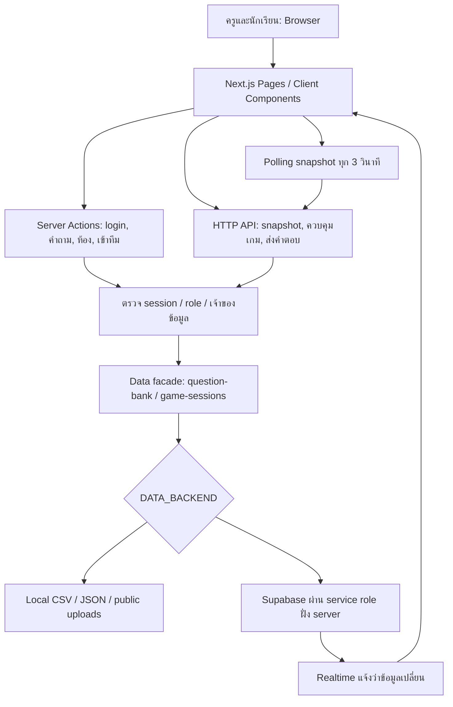
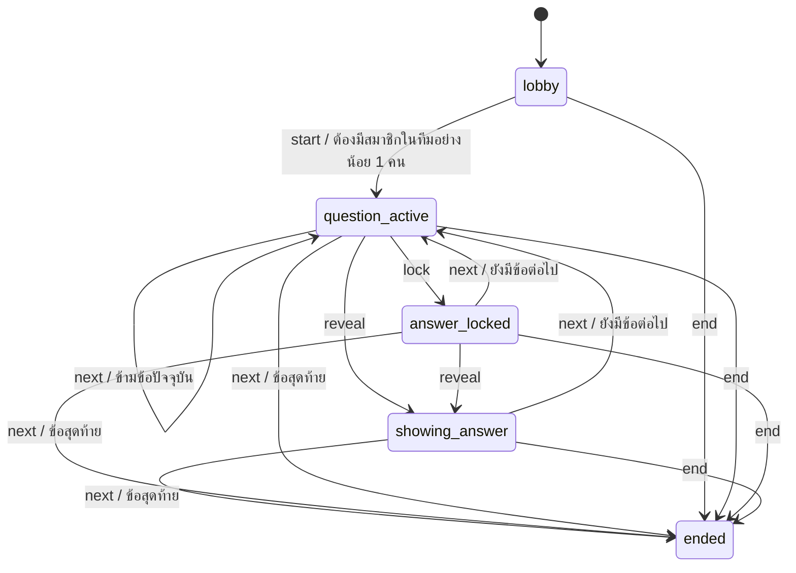

# รายงานศึกษาระบบ KruEIonline Realtime Quiz Game

> บันทึกนี้เป็นผลตรวจก่อนแก้ อ่านสถานะหลังแก้และหลักฐานทดสอบล่าสุดใน [IMPLEMENTATION-AND-AUDIT-TH.md](IMPLEMENTATION-AND-AUDIT-TH.md)

ตรวจวันที่ 9 กันยายน 2026 — อ้างอิงโค้ดในโฟลเดอร์ `Onlinegame-main` ที่ได้รับ ไม่ใช่การตรวจระบบบนเว็บไซต์ที่เปิดใช้งานจริง

## 1. ขอบเขตและผลตรวจ

อ่านโค้ดแอปใน `src` ครบทั้งหน้าจอ, Server Actions, API, authentication, data adapters, utilities และ types รวมทั้ง SQL migration ทั้ง 5 ไฟล์, seed script, configuration, เอกสาร และ Playwright tests ทั้ง 5 ไฟล์ ตรวจรายการและขนาดสื่อประกอบ โดยไม่ได้ประเมินภาพ/เสียงทุกชิ้นด้วยการเปิดเล่น

| รายการ | ผล |
|---|---|
| ติดตั้ง dependencies ตาม lockfile | `npm ci --no-audit --no-fund` สำเร็จ |
| ตรวจ lint | `npm run lint` ผ่าน |
| Production build รวม TypeScript | `DATA_BACKEND=local` และ `npm run build` ผ่าน |
| ทดสอบ logic และ API handler ด้วยข้อมูลจำลอง | สำเร็จ มีทั้งกติกาที่ผ่านและปัญหาที่ทำซ้ำได้ รายละเอียดท้ายรายงาน |
| Playwright tests เดิม | ยังไม่ได้รัน: ไม่มีข้อมูลบัญชีที่ tests อ้างถึงและไม่มีไฟล์ข้อมูลจริง ไม่ควรตีความว่า tests ผ่าน |
| Supabase จริง | ยังไม่ได้เชื่อมต่อ ไม่มี `.env.local` หรือ project credentials ในชุดไฟล์ที่ตรวจ |
| หน้าจอใน browser/หลายอุปกรณ์ | ยังไม่ได้ทดสอบ จึงไม่รับรอง responsive, contrast หรือการเข้าถึงครบทุกกรณี |
| Source control | โฟลเดอร์ที่ได้รับไม่มี `.git` จึงตรวจประวัติ commit/diff ไม่ได้ |

การตรวจครั้งนี้ไม่แก้โค้ดการทำงานของผลิตภัณฑ์ เพิ่มรายงานและเครื่องมือทดสอบใน `tmp` เท่านั้น การติดตั้ง/build สร้าง `node_modules`, `.next` และไฟล์ประกอบของ Next.js ตามปกติ

## 2. ภาพรวมระบบ

เป็นเว็บเกมตอบคำถามในห้องเรียน นักเรียนตอบรายคน แต่สะสมคะแนนและจัดอันดับเป็นทีม ครูสร้างชุดคำถามและควบคุมจังหวะเกม นักเรียนเข้าสู่ระบบแล้วใช้รหัสห้อง 4 หลักเพื่อเข้าทีม

เทคโนโลยีตาม `package.json`: Next.js 16.2.9 App Router, React 19.2.4, TypeScript, Tailwind CSS 4, Supabase JS/SSR, Zod, KaTeX, lucide-react และ Playwright โดยเวอร์ชันที่ระบุเป็นของชุดไฟล์นี้



ข้อสำคัญ: ฟังก์ชันหลายตัวชื่อ `Local...` แต่เป็นทางเข้าร่วมของทั้งสอง backend ถ้าเลือก Supabase จะส่งงานต่อให้ adapter อีกไฟล์ ชื่อฟังก์ชันไม่ได้แปลว่าใช้ไฟล์ local เสมอไป

## 3. โครงสร้างไฟล์

| ตำแหน่ง | หน้าที่ |
|---|---|
| `src/app` | Routes, server-rendered pages, Server Actions, API และ client screens |
| `src/components/layout` | AppShell: header, โลโก้, ลิงก์ login, พื้นที่ main |
| `src/components/ui` | Panel, ButtonLink, ConfirmSubmitButton, MathText, QuestionImage |
| `src/lib/auth` | อ่านบัญชี, cookie session, ตรวจ role และ token ควบคุมห้องครู |
| `src/lib/data` | คลังคำถามและวงจรเกม ทั้ง local และ Supabase |
| `src/lib/game` | ตรวจคำตอบ, สร้างรหัสห้อง, จัดทีม และ helper คะแนน |
| `src/lib/supabase` | อ่าน env, สร้าง clients, สมัครรับ Realtime |
| `src/lib/validations` | Zod schemas; ใน flow จริงใช้ schema สร้างห้อง ส่วน schema คำถาม/คำตอบยังไม่ได้เชื่อมเข้าจุดรับข้อมูล |
| `src/types` | ชนิดข้อมูลบัญชี, เกม, ตารางฐานข้อมูล |
| `supabase/migrations` | สร้าง schema, indexes, RLS, Realtime, cleanup RPC, options และ image bucket |
| `scripts/seed-supabase.mjs` | นำบัญชีและชุดคำถาม local เข้า Supabase |
| `data` | มีเพียงบัญชีตัวอย่าง 2 รายการ และ JSON ตัวอย่างที่เป็น array ว่าง |
| `public` | โลโก้, icons, metadata assets, GIF เฉลย/อันดับ, เสียง และ SVG เริ่มต้นจาก template |
| `tests` | ตัวอย่าง E2E login, คลังคำถาม, สร้างห้อง, เข้าทีม, เล่นเกม |
| `.agents`, `.codex`, `.impeccable` | เครื่องมือ/แนวทางสำหรับ agent และตรวจ UI ไม่ใช่ส่วนที่ browser ใช้เล่นเกม |
| `PRODUCT.md`, `README.md`, `HANDOFF.md`, `docs` | เป้าหมาย, กติกา, วิธีเริ่มต้น, schema และแผนงาน |

มี `PRODUCT.md` อีกฉบับที่โฟลเดอร์แม่ จึงควรอ้างอิงฉบับภายใน `Onlinegame-main` เมื่อทำงานกับแอปนี้ รายการไฟล์และฟังก์ชันพร้อมตำแหน่งอยู่ใน `CODE-MAP.md`

## 4. หน้าจอและสิทธิ์การเข้าใช้

| URL | การทำงาน |
|---|---|
| `/` | redirect ไป `/login` ไม่มีหน้าแรกแยก |
| `/login` | ฟอร์มรหัสผู้ใช้/รหัสผ่านร่วมของครูและนักเรียน แสดงข้อความ error/notice |
| `/teacher/login` | redirect ไป `/login` |
| `/teacher/question-sets` | ต้องมี session ครู แสดงชุดคำถามของครูคนนั้น พร้อมสร้างชุดใหม่ |
| `/teacher/question-sets/[questionSetId]` | ตรวจเจ้าของชุด แสดงข้อ, เฉลย, รูป, คะแนน, เวลา; เพิ่ม/ลบข้อและลบทั้งชุด |
| `/teacher/rooms/new` | เลือกชุดที่มีคำถาม ตั้งกิจกรรม/จำนวนทีม/คนต่อทีม แสดงห้องเดิมถ้ายังไม่จบ |
| `/teacher/rooms/[roomCode]/dashboard` | ตรวจครูเจ้าของห้อง สร้าง snapshot และ access token ส่งให้ client dashboard |
| `/teacher/rooms/[roomCode]/results` | ตรวจครูเจ้าของห้อง แสดงตารางทีมและรายคน; เปิดดูได้แม้เกมยังไม่จบ |
| `/join` | ต้องเป็นนักเรียน ค้นหารหัสห้อง แสดงรายละเอียดและเลือก/สุ่มทีม |
| `/play/[roomCode]` | ต้องเป็นนักเรียนและมีทีม แสดง lobby/คำถาม/เฉลย/ผลตาม snapshot |

หน้าห้องครูและหน้าเล่นมี `loading.tsx` เป็น skeleton ระหว่างโหลด ส่วน AppShell แสดงปุ่มเข้าสู่ระบบตลอด ยังไม่ได้เปลี่ยน navigation ตามผู้ใช้ที่ login แล้ว

## 5. การเข้าสู่ระบบ

1. `signInWithSheetAction` อ่านและ trim รหัสผู้ใช้กับรหัสผ่าน
2. Local อ่าน `data/student.csv` ทุกครั้งที่ตรวจบัญชี; Supabase ค้นตาราง `accounts` ผ่าน service role
3. รหัสผู้ใช้แปลงเป็นตัวพิมพ์ใหญ่ รองรับ header `id/user_code`, `name/display_name`, `grade/classroom`
4. ถ้า `role` หรือ `grade` เป็น `TEACHER` ให้เป็นครู นอกนั้นเป็นนักเรียน
5. Local ตัดแถวข้อมูลไม่ครบ และถ้ารหัสซ้ำใช้รายการท้ายสุด
6. ตรวจรหัสผ่านแบบเทียบข้อความตรง ๆ ยังไม่มี password hashing, rate limiting, reset password หรือจัดการบัญชีผ่านหน้าจอ
7. สร้าง cookie `rqg_session` จาก JSON ที่เข้ารหัส Base64url มี userCode, role, displayName, grade
8. cookie เป็น HttpOnly, SameSite=Lax, อายุฝั่ง browser 8 ชั่วโมง; ไม่มีลายเซ็น, ไม่มี expires ใน payload และยังไม่กำหนด Secure
9. ครูไปหน้าคลังคำถาม นักเรียนไปหน้าเข้าห้อง
10. `requireRole` ส่งคนที่ไม่ login ไปหน้า login และส่งคนที่ role ไม่ตรงไปหน้าของตน

มี `signOutAction` สำหรับลบ cookie แต่ไม่พบปุ่มที่เรียกใช้งานใน UI ปัจจุบัน การออกจากทีมไม่ได้ออกจากบัญชี

ตัว parser CSV รองรับ comma ภายในเครื่องหมายคำพูดแบบง่าย แต่ไม่ครบรูปแบบ CSV ที่มี escaped quotes หรือข้อความหลายบรรทัด

## 6. คลังคำถาม

### สร้างชุดและเพิ่มข้อ

สร้างชุดจากชื่อที่ไม่ว่างและคำอธิบาย optional ผูก `teacherCode` กับ session ผู้สร้าง ใช้ UUID เป็น id แสดงสรุปจำนวนข้อและผลรวมคะแนน

รองรับ 3 รูปแบบ:

| รูปแบบ | วิธีเก็บ/ตรวจ |
|---|---|
| พิมพ์ตอบ `short_text` | เก็บ correctAnswer เปรียบเทียบหลัง trim, ยุบช่องว่างหลายตัว และแปลงตัวพิมพ์เล็ก |
| ถูก/ผิด `true_false` | สร้าง options 2 ตัวคือ “ถูก” และ “ผิด” ตรวจ option id ที่นักเรียนเลือก |
| ปรนัย `multiple_choice` | ต้องกรอก 4 ตัวเลือกและเลือกข้อถูก 1 ข้อ ตรวจ option id |

คะแนนเป็นจำนวนเต็ม 0–1,000 ต่อข้อ เวลาเป็นจำนวนเต็ม 5–600 วินาที ค่าเริ่มต้น 10 คะแนน/60 วินาที รูปแบบไม่รู้จักจะกลายเป็น short_text

การตรวจข้อความไม่ใช่ระบบประเมินความหมายหรือคณิตศาสตร์: `0.5` กับ `1/2` ไม่เท่ากันโดยอัตโนมัติ และสูตรที่แสดงด้วย KaTeX ไม่ได้เปลี่ยนวิธีตรวจคำตอบ

### สูตรและรูป

`MathText` รองรับ `$...$`, `$$...$$`, `\(...\)` และ `\[...\]` แยก inline/display แล้วใช้ KaTeX โดย `trust:false`, `throwOnError:false`, `strict:ignore` ปัจจุบันส่ง output แบบ HTML

Local บันทึกรูปใน `public/uploads/question-images/<teacher>/<set>/<question>-<filename>`; Supabase upload ไป public bucket `question-images` และเก็บทั้ง URL/path มีการลบไฟล์ภาพเมื่อคำถามถูกลบ

หน้าเพิ่มคำถามยอมเลือก `image/*`; bucket Supabase ยอม PNG/JPEG/WebP/GIF จึงไม่สอดคล้องกันสำหรับภาพชนิดอื่น ไม่มีการย่อ/บีบอัดภาพที่อัปโหลดในโค้ด QuestionImage ใช้ภาพแบบ unoptimized และมีปุ่มขยายเป็น overlay

ตรวจ implementation ของ Next.js ที่ติดตั้งพบว่า Server Actions มี body limit เริ่มต้น 1 MB (`node_modules/next/dist/server/app-render/action-handler.js`) และ next.config.ts ไม่ override ค่านี้ ดังนั้นแม้ bucket ไม่กำหนด file_size_limit การอัปโหลดผ่านฟอร์มก็ยังติดเพดาน request ของ framework ได้ ยังไม่ได้ทดสอบส่งไฟล์ขนาดเกินผ่าน HTTP จริง

### ลบ

- ลบข้อเดียวหรือหลายข้อ แล้วจัด `orderIndex` ใหม่
- ลบทั้งชุด: ตรวจว่ามีห้อง active ใช้อยู่หรือไม่ ถ้ามีจะไม่ลบ
- ถ้าลบชุดได้ จะล้างห้องที่จบแล้วของชุดนั้นพร้อมรูปประกอบ
- Supabase พยายามใช้ `delete_question_set_safely` RPC ก่อน แล้ว fallback เป็นคำสั่งแยกหากยังไม่มี RPC
- ปัจจุบันยังไม่มีแก้ไขชื่อชุด/แก้ไขข้อเดิม, duplicate ชุด, import/export ผ่าน UI หรือ reorder ด้วยผู้ใช้
- การเพิ่มและลบ “รายข้อ” ยังไม่บล็อกระหว่างใช้ชุดนั้นเล่นเกม ต่างจากการลบทั้งชุด

## 7. สร้างห้องและเข้าทีม

ครูสร้างห้องได้เมื่อมีชุดคำถามอย่างน้อย 1 ข้อ และไม่มีห้องของตนที่สถานะยังไม่ ended กำหนด 1–12 ทีม แต่ละทีม 1–12 คน ชื่อกิจกรรมยาวไม่เกิน 80 ตัวอักษร ค่าสูงสุดตามฟอร์มคือ 144 คน ไม่ใช่ผลรับรองโหลดว่ารองรับพร้อมกันได้จริง

รหัสสุ่มเป็นตัวเลข 0000–9999 โดยพยายาม 100 ครั้ง Local มี fallback ไล่หารหัสว่าง ส่วน Supabase อาศัย unique index และ retry

เริ่มต้นทุกทีมชื่อ “กลุ่ม N” คะแนน 0, ตัวหารยังเป็น null, ห้องเป็น lobby, questionIndex=0 และยังไม่เริ่มเวลา จำนวนข้อ/ชื่อชุดถูกคัดลอกมาที่ห้อง แต่เนื้อหาคำถามไม่ได้ snapshot

นักเรียนค้นรหัสแล้วเห็นกิจกรรม ชุดคำถาม จำนวนข้อ จำนวนทีม จำนวนคนในทีม และสถานะห้อง เลือกทีมเองหรือสุ่มได้ การสุ่มเลือกจากทีมที่สมาชิกน้อยที่สุดในบรรดาทีมที่ยังว่าง แล้วสุ่มเมื่อเสมอกัน

คนเดิมใช้ record participant เดิม ไม่เพิ่มซ้ำเมื่อกลับเข้าห้อง ระหว่าง lobby เปลี่ยนทีมได้และออกจากทีมได้ การออกจากทีมเปลี่ยน teamId เป็น null แต่ยังเก็บ record ผู้เล่นในห้อง

หัวหน้าทีมคำนวณจากสมาชิกของทีมที่มี `joinedAt` เก่าที่สุด มีสิทธิ์เปลี่ยนชื่อทีม 2–30 ตัวอักษรเฉพาะ lobby ไม่ได้บันทึก captainId ถ้าหัวหน้าออก คนที่เหลือเข้าร่วมเก่าสุดรับสิทธิ์ต่อ อย่างไรก็ตามการเปลี่ยนทีมไม่ reset joinedAt จึงเป็นเวลาเข้าห้อง ไม่ใช่เวลาเข้าทีมปัจจุบันเสมอไป

เมื่อเริ่มเกมแล้ว คนที่เคยมีทีมจะกลับทีมเดิม แม้ส่ง teamId อื่นมา ส่วนคนใหม่เข้าทีมที่ว่างได้และตอบได้ แต่ `isScoreEligible=false` ไม่เพิ่มตัวหาร ทีมเต็มทั้งหมดจะไม่สามารถรับ late join ใหม่ได้

## 8. วงจรเกมและเวลา



เมื่อกดเริ่ม ระบบล็อกจำนวนสมาชิกแต่ละทีม กำหนดสิทธิ์คะแนนให้คนในทีม ล้าง answers/คะแนนของรอบ เปิดข้อแรกและตั้ง `startedAt` กับ `currentQuestionEndsAt` จากเวลา server

คำสั่ง `next` ใช้ได้ขณะเปิดคำถามด้วย ไม่บังคับให้ล็อก/เฉลยก่อน และ `end` จบได้ทันทีแม้ยังอยู่ lobby ไม่มี pause/resume หรือย้อนกลับข้อก่อนหน้า สถานะ `playing` ยังอยู่ใน types/SQL/labels แต่ flow ปัจจุบันไม่สร้างสถานะนี้

Browser ปรับนาฬิกาทุก 1 วินาที ใช้เวลาของเครื่องเทียบ timestamp ที่ server ส่งมา ไม่มีชดเชย clock skew เมื่อหมดเวลาปุ่มตอบถูกปิด และ server ปฏิเสธคำตอบช้า แต่สถานะห้องยังเป็น question_active จนกว่าครูจะสั่งเอง ไม่มี scheduler เปลี่ยนสถานะอัตโนมัติ

## 9. การตอบและคะแนน

Server ตรวจห้องยังไม่จบ, status เป็น question_active, นักเรียนมี participant/team, ยังไม่ตอบ questionIndex นี้, มีคำถามปัจจุบัน และยังไม่หมดเวลา

คำตอบพิมพ์ห้ามว่างและยาวไม่เกิน 2,000 ตัวอักษร ตัวเลือกต้องเป็น id ของ options ในข้อปัจจุบัน คนตอบถูกได้คะแนนตามข้อ คนตอบผิดได้ 0 ส่วนผู้เข้าหลังเริ่มเกมจะได้ 0 แม้ตอบถูก

```text
คะแนนรวมทีม = ผลรวม scoreAwarded ของ answers ที่เป็นของทีมนั้น
คะแนนเฉลี่ย = คะแนนรวมทีม / lockedMemberCount
```

ปัดทศนิยม 2 ตำแหน่งก่อนจัดอันดับ จัดเรียงคะแนนมากไปน้อย ถ้าเท่ากันใช้อันดับร่วมแบบ 1,1,3 ทีมที่ตัวหารเป็น 0 แสดงแต่ไม่จัดอันดับ คะแนนเฉลี่ยอาจเท่ากันหลังปัดเศษแม้ค่าแท้จริงต่างกัน

ตัวอย่าง: ทีม A มี 5 คน ตอบถูก 4 คน ข้อละ 10 ได้เฉลี่ย 40/5=8; ทีม B มี 3 คนถูกทั้งหมด ได้ 30/3=10 ทีม B จึงนำ ไม่เพิ่มคะแนนจากความเร็ว

ก่อนเฉลย student snapshot ตั้ง currentAnswer.isCorrect=false และ scoreAwarded=0 ไว้แทนค่าจริง พร้อม `isAnswerRevealed=false`; UI ใช้ flag นี้แสดง “รอครูเฉลย” คำถาม/option ไม่ส่งเฉลย และ teamScore/rankedTeams หักคะแนนข้อปัจจุบันออก อย่างไรก็ตามมีการส่ง nested `team` ที่ยังมีคะแนนจริง เป็นช่องข้อมูลรั่วที่ยืนยันแล้ว

API ส่งคำตอบไม่มี questionId/questionIndex ของข้อที่ผู้ใช้เห็น Server ผูกคำตอบเข้าข้อที่กำลังเปิดตอน request มาถึง จึงเสี่ยงรับคำตอบข้อความของข้อเก่าเป็นข้อใหม่เมื่อครูเปลี่ยนข้อระหว่าง network delay

## 10. Dashboard, หน้าเล่น, เสียงและผล

Dashboard แสดงรหัส/ความจุห้อง รายชื่อนักเรียนพร้อมทีมและ late join คำถาม/ภาพ/ตัวเลือก เวลา จำนวนคนตอบ รายชื่อแยกทีม คะแนนรวม-เฉลี่ย และอันดับ พร้อมปุ่ม start/lock/reveal/next/end ระหว่างส่งคำสั่งจะ disable ปุ่มชุดควบคุม

คะแนนฝั่งครูรวมข้อปัจจุบันทันที ไม่ได้ซ่อนเหมือน student teamScore แถบคะแนนใช้ `min(averageScore*10,100)%` ทำให้ทีมที่ได้ 10 คะแนนขึ้นไปแถบเต็มเท่ากัน ไม่ใช่สัดส่วนจากคะแนนเต็มของชุด

หน้าเล่นมี draft แยกตาม questionIndex ส่งได้ครั้งเดียวต่อข้อ แสดงสถานะส่งแล้วหลัง refresh หัวหน้าทีมเห็นฟอร์มชื่อทีมและ notice ครั้งแรก โดยใช้ localStorage ตามห้อง/ทีม

เสียงเริ่มต้นปิด ครูเปิดเพลงเอง นักเรียนเมื่อส่งคำตอบจะเรียกเปิดเสียงหากยังปิดอยู่ จึงมีกรณีผู้ใช้กดปิดเสียงแล้วส่งคำตอบครั้งถัดไปเสียงกลับมาเปิด การเล่นเสียงมี catch สำหรับ browser ที่ไม่อนุญาต autoplay

เมื่อเฉลย นักเรียนที่ส่งคำตอบเห็น GIF ถูก/ผิดประมาณ 3.6 วินาที เมื่อจบเกมแสดงภาพอันดับและ popup ปิดเพื่อดูสรุปเต็มได้ อันดับ 4 ขึ้นไปใช้ GIF ร่วมกัน

หน้าสรุปครูมีตารางอันดับทีมและตารางรายคน: ทีม, ตอบกี่ข้อ, ถูกกี่ข้อ, คะแนนที่ทำได้, สิทธิ์คะแนน เรียงรายคนตามชื่อทีม ต่อด้วยคะแนนและชื่อภาษาไทย

“จบเกม” เปลี่ยนสถานะและคงข้อมูลไว้ “ปิดห้อง” ลบข้อมูลรอบนั้นรวมทีม/ผู้เล่น/คำตอบ/events แต่คงคลังคำถาม ไม่พบระบบล้างผลอัตโนมัติตามอายุ, export, print layout หรือหน้ารายการประวัติห้องทั้งหมด

## 11. API contract

| Endpoint | Method / payload | ผล |
|---|---|---|
| `/api/play/[roomCode]` | GET, session นักเรียน | StudentPlaySnapshot หรือ 401/404 |
| `/api/play/[roomCode]` | POST `{answerText}` หรือ `{selectedOptionId}` | ส่งคำตอบ; action เริ่มต้นเป็น answer |
| `/api/play/[roomCode]` | POST `{action:"rename_team",teamName}` | เปลี่ยนชื่อทีมตามสิทธิ์ captain |
| `/api/play/[roomCode]` | POST `{action:"leave_team"}` | ออกจากทีม ส่ง redirectTo ไป join |
| `/api/teacher/rooms/[roomCode]/dashboard` | GET, cookie ครูหรือ `teacher_access_token` query | TeacherDashboardSnapshot |
| `/api/teacher/rooms/[roomCode]/control` | POST `{command:"start"|"lock"|"reveal"|"next"|"end"}` | ใช้ cookie ครูหรือ header `x-teacher-access-token`, ส่ง snapshot หลังสั่งงาน |

คำสั่ง/กติกาไม่ผ่านส่ง 400; ครูไม่มีสิทธิ์ส่ง 401 โดย dashboard แยกได้ว่ามีห้องอยู่หรือไม่ด้วย 401/404 JSON ผิดรูปแบบถูก catch เป็น null แต่ exception จากฐานข้อมูลส่วนมากไม่ได้แปลงเป็นข้อความที่เหมาะสมในแต่ละ API

## 12. Realtime และ reconnect

ทั้งครูและนักเรียน poll ทุก 3 วินาที เมื่อ ended ลดเป็นทุก 10 วินาที ยัง poll อยู่แม้ Realtime ต่อสำเร็จ

Supabase subscription ติดตาม game_sessions, teams, participants, answers และ game_events ตาม sessionId เหตุการณ์ไม่ได้นำมา merge ที่ client โดยตรง แต่ debounce 80ms แล้ว fetch snapshot เต็มอีกครั้ง ถ้าไม่มี public env จะ fallback เป็น polling

Local: การ GET student snapshot เขียน lastSeenAt และ updatedAt กลับไฟล์ทุกครั้ง ทำให้แม้การอ่านสถานะก็เป็นการเขียนทั้งไฟล์ Supabase: GET snapshot ไม่อัปเดต heartbeat; lastSeen เปลี่ยนตอน join/submit และบางคำสั่งเท่านั้น ไม่พบกระบวนการเปลี่ยนคนเป็น offline จากเวลาที่ขาดการติดต่อ

Refresh/reconnect ดึง participant เดิมและคำตอบเดิมจาก server ได้ แต่ยังไม่มี request version หรือ AbortController กัน response เก่ามาทับสถานะใหม่ หน้าเล่นเมื่อ HTTP เป็น 401/404 จะ return เงียบ ๆ จึงอาจค้างภาพเก่าเมื่อ session หมดอายุหรือครูลบห้อง

## 13. การจัดเก็บข้อมูลและ migration

| ตาราง | ข้อมูล/ข้อจำกัดหลัก |
|---|---|
| accounts | รหัสบัญชี PK, ชื่อ, password ข้อความ, grade, role |
| question_sets | owner teacher_code, ชื่อ/คำอธิบาย/เวลา |
| questions | คำถาม, เฉลย, คะแนน/เวลา, ประเภท, image URL/path; unique ชุด+order |
| question_options | option text/is_correct/order; unique ข้อ+order และถูกได้ไม่เกิน 1 option |
| game_sessions | ห้อง, เจ้าของ, ชุด, จำนวนข้อ, สถานะ, timer; unique active room code/teacher |
| teams | ผูก session, team number/name, คะแนนและตัวหาร; unique session+team number |
| participants | ผูก session/team/account, eligibility และ lastSeen; unique session+student |
| answers | ผูก session/question/team/participant/student, ผลตรวจ/คะแนน; unique session+questionIndex+student |
| game_events | เหตุการณ์และ JSON payload เพื่อการอัปเดตข้อมูล |

`001`: schema หลัก, triggers updated_at, indexes, RLS และ Realtime publication

`002`: เพิ่มตารางเข้า publication แบบตรวจว่ามีอยู่แล้วก่อน

`003`: timer fields, event types และนโยบายอ่านข้อมูล gameplay

`004`: cleanup functions แบบ security definer จำกัด execute ให้ service_role

`005`: question_type, question_options, selected_option_id, image_path และ public image bucket

การลบ session cascade ไปข้อมูลรอบเล่น คำถามที่ถูกลบทำให้ FK ใน answers เป็น null เพื่อเก็บผลเดิมได้ ส่วนการลบชุดที่ยังมี session จะติดข้อจำกัดและต้องจัดการผ่าน flow cleanup

โหมด backend เลือกจาก DATA_BACKEND ถ้าระบุ local/supabase ใช้ค่านั้น ถ้าไม่ระบุและมี URL+service key จะเลือก Supabase อัตโนมัติ การกำหนด DATA_BACKEND=supabase แต่ไม่ใส่ค่าที่จำเป็นไม่ได้ fallback ไป local

Service role อยู่ฝั่ง server; browser ใช้ public URL/key แต่ระบบ login นี้ไม่ได้ใช้ Supabase Auth จึงไม่ควรถือว่า RLS แยกสิทธิ์ผู้ใช้ตามบัญชีใน cookie ให้โดยอัตโนมัติ

Seed script upsert บัญชีและชุดคำถาม/คำถามจากไฟล์ local ไม่ย้ายห้องหรือผล และปัจจุบันยังไม่ย้าย question_type/options/images ของคำถามรุ่นใหม่ การ seed จึงยังไม่ใช่การย้ายข้อมูลครบทุกฟีเจอร์

## 14. ปัญหาที่พบและลำดับแก้ไข

P0 = สิทธิ์ควบคุมระบบหลุด, P1 = กระทบความถูกต้อง/ความลับ/การเล่นหลัก, P2 = พฤติกรรมหรือการใช้งานที่ควรปรับปรุง การจัดลำดับนี้ใช้กับสภาพโค้ดที่ตรวจ

| ระดับ | ปัญหาและหลักฐาน | ผลกระทบ / แนวทาง |
|---|---|---|
| P0 | `auth/teacher-room-access.ts:31` token เป็น Base64 ของ roomCode/sessionId ซึ่ง student snapshot ส่งให้แล้ว; เรียก control handler ด้วย token ที่สร้างจาก snapshot โดยไม่มี login ได้ HTTP 200 | นักเรียนควบคุม start/lock/reveal/next/end ได้ ต้องใช้ session ครูที่ตรวจสอบได้ หรือ signed token แบบจำกัดสิทธิ์/อายุ |
| P0 | `auth/session.ts:8` cookie ไม่มี MAC/signature; ทดสอบ parser กับ cookie จำลองรับ role=teacher | ปลอมตัวเป็นครู/นักเรียนได้ ควรใช้ session id แบบสุ่มเก็บ server หรือ signed session ที่ตรวจ expiry และกำหนด Secure |
| P1 | RLS ใน migrations 001/003 เป็น `using(true)` สำหรับข้อมูล gameplay; 005 เปิดอ่าน question_options รวม is_correct | เมื่อใช้ schema นี้ anon อ่านรายชื่อ/คำตอบ/ผล/ตัวเลือกถูกข้ามห้องได้ ต้องจำกัดข้อมูลอ่านและแยกข้อมูลเฉลยออกจาก public view; ยังไม่ได้ทดสอบ project จริง |
| P1 | `data/game-sessions.ts:310` read-modify-write ทั้งไฟล์ไม่มี lock; ทดสอบ concurrent join 8 requests สำเร็จ 8 แต่เหลือ participant 1 | สมาชิก/คำตอบ/คะแนน/คำสั่งเกมอาจเขียนทับกัน แม้ polling ก็เขียน ควรใช้ transactional store หรือ serialize การเปลี่ยนแปลงและ atomic write |
| P1 | `data/game-sessions.ts:759` lookup ใช้ find รายการแรก แต่ generator อนุญาต reuse รหัสห้อง ended; ทดสอบแล้วได้ห้องเก่า | ห้องใหม่เข้าหรือควบคุมไม่ได้เมื่อรหัสซ้ำอดีต ต้องเลือก active/latest และใช้ sessionId สำหรับอ้างอิงประวัติ |
| P1 | `data/game-sessions.ts:505` อ่านคำถามต้นฉบับด้วย currentQuestionIndex; delete รายข้อไม่ตรวจ active room | ลบข้อระหว่างเกมทำให้เนื้อหาของ index เดิมเปลี่ยน ยืนยันแล้ว ควร snapshot คำถามของรอบหรือ lock การแก้ไขชุดที่ใช้งาน |
| P1 | `data/game-sessions.ts:1639` ส่ง team จริงแม้ teamScore ถูกซ่อน | ก่อนเฉลย API ส่ง rawScore=10 แต่ teamScore=0 ยืนยันแล้ว ต้องส่ง visibleTeam ในทุก field ที่เปิดให้ผู้เล่น |
| P1 | Play POST รับเพียงข้อความ/option ไม่รับ id ของข้อที่ client ตอบ | request ช้าอาจลงข้อใหม่ โดยเฉพาะ short_text ต้องส่ง expected sessionId/questionId/index และตรวจตรงกัน |
| P1 | Supabase join/start/score เป็นหลายคำสั่งแยก ไม่มี transaction/row lock ใน adapter | เสี่ยงทีมเกินความจุ, สิทธิ์คะแนนไม่ตรงตอน start, การคำนวณคะแนนเก่าทับใหม่ หรือบันทึกคำตอบสำเร็จแต่ขั้นถัดไปล้มเหลว เป็นความเสี่ยงจากโค้ด ยังไม่ทดสอบ concurrency บน DB จริง |
| P1 | `scripts/seed-supabase.mjs` ไม่ส่งประเภท/options/images | ย้ายคำถามแบบใหม่แล้วอาจกลายเป็นพิมพ์ตอบหรือรูปหาย ต้องเพิ่ม migration ของข้อมูลส่วนนี้ |
| P2 | `app/join/actions.ts:14` เติม `?error`/`?notice` ต่อท้าย URL ที่มี `?room_code` แล้ว | ได้ `room_code=1234?error=...` ทำให้รหัสห้องเสีย ยืนยัน redirect digest แล้ว ต้องประกอบ query ด้วย URLSearchParams |
| P2 | timer ไม่เปลี่ยน status และใช้เวลาของ client แสดงนับถอยหลัง | หน้าจอขึ้นเปิดรับแม้หมดเวลา; เครื่องเวลาคลาดเคลื่อนแสดงเวลาต่างกัน ควร sync server time และระบุกติกาล็อกสถานะให้ชัด |
| P2 | GET snapshot ไม่มี online timeout และ Supabase ไม่ touch lastSeen | ไม่สามารถใช้ field online/offline เป็นหลักฐานว่าผู้เล่นเชื่อมต่ออยู่จริง |
| P2 | poll/realtime ไม่มี version guard, HTTP 401/404 หน้าเล่นถูกละไว้ | หน้าอาจย้อนกลับหรือค้างข้อมูลเก่า ควรตรวจ version, ยกเลิก requests และแสดงเส้นทางกลับ login/join |
| P2 | อัปโหลด image/* แต่ Supabase bucket รับเพียง 4 MIME types; ไม่กำหนดขนาดใน UI/application | ผู้ใช้เลือกไฟล์ที่ backend ปฏิเสธได้ และรูปใหญ่ส่งให้ทั้งห้อง ควรทำ validation/ขนาด/ข้อความผิดพลาดให้ตรงกัน |
| P2 | `play-room.tsx` submitAnswer เปิดเสียงทุกครั้งที่ isSoundEnabled=false | การ mute ไม่คงอยู่เมื่อส่งคำตอบใหม่ ควรแยก “ผู้ใช้ปิดเสียง” จาก “ยังไม่เปิดเสียงครั้งแรก” |
| P2 | ไม่มีปุ่ม logout แม้มี action; จบเกมยังเก็บข้อมูลจนผู้ใช้ลบ | การใช้เครื่องร่วมกันและการเก็บผลไม่ตรงความเข้าใจของผู้ใช้บางกรณี |

ประเด็นเพิ่มเติม: CSV parser ยังไม่ครบมาตรฐาน, ฟอร์มบางจุดไม่มี pending state ป้องกันกดซ้ำ, ชื่อชุด/คำถามไม่มี max length ฝั่ง action, option index ที่ไม่ส่งถูกแปลงด้วย Number("") เป็น 0, ชื่อหัวหน้าทีมอิงเวลาเข้าห้อง, หน้ารวมชุดไม่แสดง notice หลังลบ และ retry สร้างห้อง Supabase มอง unique violation ทุกชนิดเป็นรหัสห้องชน แม้จริงอาจเป็น active teacher ซ้ำ

## 15. ข้อสังเกตด้านหน้าจอจากโค้ด

สิ่งที่มีอยู่แล้ว: `lang=th`, label ฟอร์มหลัก, ข้อความแสดงข้อผิดพลาด, ปุ่มหลายจุดสูง 44px ขึ้นไป, table อยู่ใน overflow container, responsive breakpoints, dark theme tokens และ focus style ใน shared ButtonLink

ช่องว่างที่ยืนยันจาก markup: textarea คำตอบและ input ตัวเลือกบางตัวไม่มี label ชัดเจน, choice buttons ไม่มี aria-pressed/radio state, overlay รูป/ผลไม่มี dialog semantics หรือจัดการ focus/Escape, สถานะตอบแล้วในรายชื่อครูอาศัยสีเป็นหลัก และ reduced-motion CSS ไม่หยุด animation ภายใน GIF

สื่อบางชิ้นใหญ่: rank-4-plus.gif ประมาณ 7.87 MB, reveal-wrong.gif ประมาณ 6.32 MB, รูปอันดับแต่ละชิ้นประมาณ 2.3–2.7 MB และเพลงพื้นหลังประมาณ 1.32 MB มีการ preload เสียงในหน้าเล่น/ครู ควรทดสอบการดาวน์โหลดพร้อมกันทั้งห้อง

Theming ใช้ override ชื่อ utility เช่น bg-white ให้กลายเป็นพื้นมืด ทำให้การอ่านชื่อ class ไม่ตรงสีจริง ชื่อฟอนต์เป็น Geist Latin และอาศัย fallback สำหรับภาษาไทย ไม่มี DESIGN.md ในชุดไฟล์

ไม่ให้คะแนน audit UI รวม/ไม่รับรอง WCAG เพราะยังไม่ได้วัด contrast หรือทดสอบ keyboard/mobile ใน browser ส่วนการตรวจนี้ใช้ Impeccable เป็นแนวทางอ่านโค้ด ไม่ใช่การตรวจ visual เต็มรูปแบบ สคริปต์ context.mjs และ reference/product.md ที่ AGENTS อ้างถึงไม่มีแล้ว ใช้ launcher ปัจจุบันอ่าน PRODUCT ได้สำเร็จ เป็นเอกสารอ้างอิงที่ควรปรับภายหลัง

## 16. สิ่งที่เอกสารเดิมคลาดเคลื่อนหรือยังไม่มี

- README/HANDOFF อธิบายหลัก ๆ เป็นคำถามข้อความและ polling แต่โค้ดเพิ่มตัวเลือก ภาพ สูตร เสียง Realtime และรายงานรายคนแล้ว
- คู่มือ Supabase ยก migration 001 เป็นหลัก แต่ฟีเจอร์ปัจจุบันต้องพิจารณา migrations ถึง 005
- บัญชีตัวอย่างมีรหัสแบบ T001/S001 แต่ tests ใช้บัญชีคนละชุด จึง copy ตัวอย่างอย่างเดียวแล้วรัน tests เดิมไม่ได้
- คำว่าเก็บผลเฉพาะรอบไม่ใช่ลบเมื่อจบอัตโนมัติ โค้ดคงผลจนปิดห้อง/ลบชุด
- manifest มี standalone/icons แต่ไม่พบ service worker จึงไม่ใช่ระบบเล่น offline ใน browser; local backend หมายถึง server ใช้ไฟล์ในเครื่อง
- `src/data/demo-questions.ts`, scoring helpers, question/answer validation schemas และ Supabase SSR server client บางตัวยังไม่ถูกเรียกจาก flow หลัก
- ไม่มีระบบสมัครสมาชิก, เปลี่ยนรหัสผ่าน, dashboard จัดการบัญชี, นำเข้าข้อสอบผ่าน UI, แก้ไขข้อเดิม, ประวัติการแข่งขันรวม, export ผล หรือสุ่มลำดับข้อ/ตัวเลือก

## 17. หลักฐานการทดสอบและข้อจำกัด

`tmp/audit-runtime.cjs` transpile โค้ด TypeScript เดิมเพื่อเรียก data functions และ API handler ใช้ temporary working directory ใต้ tmp ให้ไฟล์ JSON/รูปทั้งหมดอยู่ในพื้นที่จำลอง Mock เฉพาะ cookie provider ของ Next headers สำหรับทดสอบ auth ไม่ได้รันผ่าน browser หรือ HTTP server จริง

กติกาที่ตรวจผ่าน: เริ่มห้องว่างไม่ได้, เข้าทีม, จำกัดทีมเต็มในคำขอตามลำดับ, สิทธิ์หัวหน้า, ออกจากทีมก่อนเริ่ม/ห้ามหลังเริ่ม, ตรวจคำตอบข้อความแบบ normalize, true/false และปรนัย 4 ตัวเลือก, ป้องกันตอบซ้ำตามลำดับ, refresh snapshot หลังตอบ, late join ได้ 0, ล็อกตัวหาร, อันดับร่วม/ทีมว่าง, ซ่อน designated answer fields ก่อนเฉลย, เก็บ/ลบรูป local, กันลบทั้งชุดระหว่าง active และ cleanup ห้อง ended เมื่อลบชุด

ปัญหาที่ reproduce: teacher token จาก student snapshot, unsigned cookie, คะแนนจริงใน nested team ก่อนเฉลย, local concurrent write สูญหาย, reuse room code คืนห้องเก่า, ลบข้อระหว่างเกมเปลี่ยนคำถามเดิม, timeout คง status และ query redirect ผิด

ผลเครื่องอ่านได้อยู่ที่ `tmp/audit-runtime-results.json` การที่ harness สำเร็จหมายถึง assertions ที่เลือกผ่านและยืนยันปัญหาได้ ไม่ใช่การรับรองว่าแอปไม่มี bug

ขั้นทดสอบต่อที่ยังจำเป็นหลังแก้ประเด็นหลัก: browser E2E กับบัญชี fixtures ที่แยกจาก production, Supabase จริงหลัง migrations, การตอบ/เข้าทีมพร้อมกัน, teacher เปลี่ยนข้อขณะ request ยังเดินทาง, disconnect/reconnect, มือถือ/โปรเจกเตอร์, screen reader/keyboard และการอัปโหลดภาพขนาดต่าง ๆ

ลำดับดำเนินการที่แนะนำ: ปิดช่องสิทธิ์ P0 → แก้ RLS และข้อมูลเฉลย → ทำการอัปเดตเกมแบบ transaction → snapshot คำถามและตรวจ request ตามข้อ → แก้ redirect/seed/สถานะเครือข่าย → ทดสอบ end-to-end และโหลดจริง → ปรับหน้าจอจากผลทดสอบ
